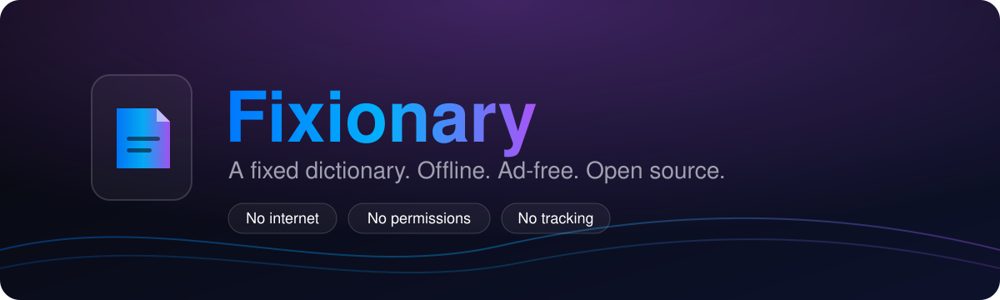
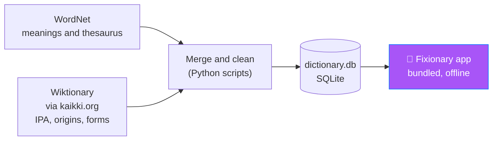

<p align="center">
  
</p>

<p align="center">
  <a href="https://bips-git.github.io/fixionary/"><b>🌐 Website</b></a>
  &nbsp;&nbsp;|&nbsp;&nbsp;
  <a href="https://github.com/bips-git/fixionary/releases"><b>📦 Releases</b></a>
  &nbsp;&nbsp;|&nbsp;&nbsp;
  <a href="https://github.com/bips-git/fixionary">🐙 GitHub</a>
  &nbsp;&nbsp;|&nbsp;&nbsp;
  <a href="https://codeberg.org/bips-git/fixionary">🏔️ Codeberg</a>
</p>

<p align="center">
  
  
  
  
</p>

## 👋 What is Fixionary?

**Fixionary** is a fast, private English dictionary for Android. The name is a small joke with a real meaning: a *fixed* dictionary. It fixes the things that make most dictionary apps annoying.

| 😤 The usual problem | ✅ The Fixionary fix |
|---|---|
| Needs the internet for every lookup | The whole database is **bundled**. It works on a plane, in a tunnel, anywhere |
| Ads between every word | **Zero ads** |
| Asks for permissions and tracks you | **No permissions** and **no tracking**. No accounts, no analytics |
| Closed source, so you must trust it | **Open source** under GPL-3.0-or-later |
| Slow or fussy search | **Instant, typo-tolerant** search, plus search by meaning |

There are no AI features inside the app. It is a dictionary, built carefully from open linguistic data.

## ✨ Features

| | What you get |
|---|---|
| 🔎 | **Fast search-first home screen.** Big search bar, word of the day and recent lookups |
| 🩹 | **Typo-tolerant search.** Misspell a word and Fixionary still finds it |
| 💡 | **Search by meaning.** Describe an idea and find the word for it |
| 📖 | **Rich entries.** Meanings, parts of speech, synonyms, antonyms and a built-in thesaurus |
| 🗣️ | **Pronunciation (IPA)** for words, so you know how to say them |
| 🌱 | **Word origins** and **word forms**, including "form of" notes (for example, which word an inflected form comes from) |
| ⭐ | **Favourites and history** to save and revisit words |
| 🎨 | **Material 3 design** with an indigo-violet brand palette and smooth motion and haptics |
| ⚙️ | **Settings** to tune the app to your taste |
| 🔒 | **Private by design.** No network permission is needed to look up a word |

> [!NOTE]
> Fixionary is under active development. The sections below list what works today and what is planned.

## 📥 Download

> [!IMPORTANT]
> Fixionary is not yet listed on any app store. GitHub Releases is the only official source right now. The other channels are planned and are marked below.

| Source | Status | Notes |
|---|:-:|---|
| 🐙 **GitHub Releases** | ✅ Available | [Latest APK](https://github.com/bips-git/fixionary/releases/latest) |
| 🟢 **F-Droid** | 🕓 Coming soon | Planned |
| 🔄 **Obtainium** | 🕓 Coming soon | Add the GitHub repo URL as the source once releases are signed |
| 🛡️ **Accrescent** | 🕓 Coming soon | Planned |
| 📲 **Direct download** | 🕓 Coming soon | Via the [website](https://bips-git.github.io/fixionary/) |

**Install steps (APK):**

1. Download the latest `.apk` from the [Releases](https://github.com/bips-git/fixionary/releases) page.
2. Allow installs from your browser or file manager when Android asks.
3. Open the file and tap **Install**.

> [!TIP]
> Always compare the SHA-256 checksum shown on the release page with your downloaded file before installing.

## 🧰 Built with

<p>
  
</p>

| Layer | Choice |
|---|---|
| Language | Kotlin |
| UI | Jetpack Compose with Material 3 |
| Data | Bundled **SQLite** database, built by a Python data pipeline |
| Build | Gradle (Android Gradle Plugin), optimised release builds |
| Package id | `io.github.bips_git.fixionary` |
| Website | Plain HTML, CSS and JS in [`docs/`](docs/), served by GitHub Pages |

### 🗃️ Where the words come from

The dictionary is assembled by a reproducible pipeline that merges open lexical sources into one SQLite file:



## 🛠️ Build from source

You need a recent **JDK**, the **Android SDK** and **Git**. The project is developed with a current JDK and Gradle 9.x.

```bash
git clone https://github.com/bips-git/fixionary.git
cd fixionary

# Debug build for quick testing
./gradlew assembleDebug

# Optimised release build
./gradlew assembleRelease
```

The APK appears under `app/build/outputs/apk/`.

<details>
<summary><b>🗂️ Project layout</b></summary>

```text
.
├── app/            # Android app (Kotlin + Jetpack Compose)
├── docs/           # Project website (GitHub Pages)
├── assets/         # README banner and images
├── LICENSE         # GPL-3.0-or-later
└── README.md
```

The data pipeline and the SQLite build are documented alongside their scripts. Adjust this layout to match your repo if folders differ.

</details>

## 🗺️ Roadmap

- [x] Search-first home, word of the day, recents
- [x] Typo-tolerant search and search by meaning
- [x] Pronunciation, favourites, history and settings
- [x] Origins, word forms and form-of notes (Wiktionary enrichment)
- [x] Motion, haptics and an **About and licences** screen
- [x] Adaptive "folded page" app icon
- [ ] Commit-triggered build pipeline with versioned APKs
- [ ] Release signing key
- [ ] Baseline profile and further performance tuning
- [ ] F-Droid, Obtainium and Accrescent listings

## 🤝 Contributing

Found a wrong definition, a missing word or a bug? Please open an issue on [GitHub](https://github.com/bips-git/fixionary/issues) or [Codeberg](https://codeberg.org/bips-git/fixionary/issues). Pull requests are welcome on either host.

For data problems, say which word is affected and, if you can, link a source. Note that most entries come from upstream projects, so corrections to the underlying data may also be worth sending to [Wiktionary](https://www.wiktionary.org) or [WordNet](https://wordnet.princeton.edu).

## 📄 License

Fixionary is free software, released under the **GNU General Public License v3.0 or later**. See the [LICENSE](LICENSE) file. Copyright © Bipul Das.

Dictionary data comes from third-party open projects that have their own licences. The full list is in the app under **About and licences**.

## 🙏 Thanks

[Princeton WordNet](https://wordnet.princeton.edu) · [Wiktionary](https://www.wiktionary.org) and [kaikki.org](https://kaikki.org) · [Jetpack Compose](https://developer.android.com/jetpack/compose) · [Material Design](https://m3.material.io) · [WM Keyboard](https://github.com/wasi-master/wmkeyboard) for design inspiration · [Skill Icons](https://skillicons.dev)

---

<p align="center">
  <sub>📖 A fixed dictionary. Offline, ad-free, private.<br>
  Not affiliated with any other product or company named Fixionary.</sub>
</p>
